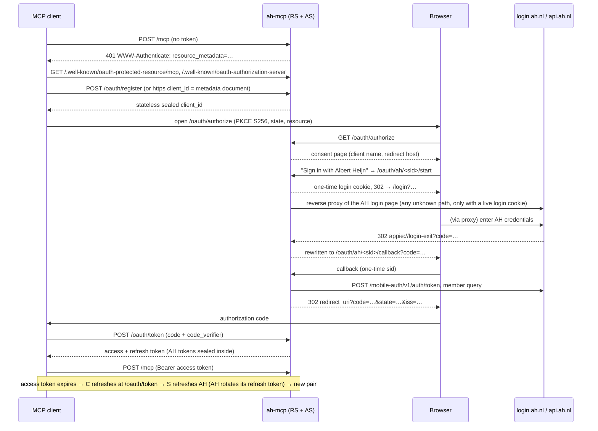

# ah-mcp

A self-hostable **Albert Heijn MCP server** for AI agents. Each person connects
their MCP client (Claude Code, Cursor, Claude Desktop, claude.ai web and mobile)
and **signs in with their own Albert Heijn account via OAuth**. Agents can then:

- search the AH assortment and look up products, stores and last-chance bargains;
- manage the shopping list (basket) and, if one exists, the active online order;
- check bonus offers against the user's buying habits for a cheaper basket;
- read orders, receipts, purchase history and savings.

It runs on your own infrastructure (Docker or Kubernetes), speaks **MCP Streamable
HTTP only**, and keeps **no persistent state**.

> **License: AGPL-3.0-or-later.** ah-mcp builds on
> [gwillem/appie-go](https://github.com/gwillem/appie-go) (AGPL-3.0) and adapts
> code from several AGPL forks (see [UPSTREAM.md](UPSTREAM.md)). If you run a
> **modified** version as a network service, AGPL §13 requires you to offer its
> users the corresponding source code.

## Contents

- [What it is / is not](#what-it-is--is-not)
- [Quick start (Docker Compose + Caddy)](#quick-start-docker-compose--caddy)
- [Connecting MCP clients](#connecting-mcp-clients)
- [Kubernetes notes](#kubernetes-notes)
- [Configuration](#configuration)
- [Auth flow](#auth-flow)
- [Allowlist](#allowlist)
- [Key rotation / log everyone out](#key-rotation--log-everyone-out)
- [Domain model: basket vs active order](#domain-model-basket-vs-active-order)
- [Tool catalogue](#tool-catalogue)
- [Security model](#security-model)
- [Known gaps](#known-gaps)
- [Troubleshooting](#troubleshooting)
- [Upstream sources & how to sync](#upstream-sources--how-to-sync)
- [Design decisions](#design-decisions)
- [License and attribution](#license-and-attribution)

## What it is / is not

**It is** an MCP server with 25 tools, an in-house OAuth 2.1 authorization
server (with an Albert Heijn login proxy), and nothing else: one binary, one port.

**It is not** a shopping robot that checks out. Out of scope, by design:

- delivery slots, checkout, order creation, or reopening/editing a placed order;
- activating personal bonus (Bonus Box) offers — they are listed read-only;
- product comparison or web reviews (agents do that themselves);
- favourite lists, checking/unchecking list items;
- SSE or stdio transports, static bearer tokens or shared secrets;
- Belgium (`AH_SITE=nl` only).

## Quick start (Docker Compose + Caddy)

You need a host with Docker and a DNS name pointing at it (e.g. `ah-mcp.example.com`).

```sh
git clone https://github.com/fedorov-xyz/ah-mcp && cd ah-mcp
cp .env.example .env
# Generate the sealing key and set your public URL:
sed -i.bak "s|^AH_MCP_SECRET_KEY=.*|AH_MCP_SECRET_KEY=$(openssl rand -base64 32)|" .env
sed -i.bak "s|^AH_MCP_BASE_URL=.*|AH_MCP_BASE_URL=https://ah-mcp.example.com|" .env
# Strongly recommended: restrict who may sign in.
sed -i.bak "s|^AH_MCP_ALLOWED_EMAILS=.*|AH_MCP_ALLOWED_EMAILS=you@example.com|" .env
docker compose up -d
```

The container listens on `127.0.0.1:3000`. Put a TLS reverse proxy in front;
[`deploy/Caddyfile`](deploy/Caddyfile) is a one-site example (TLS is automatic):

```caddy
ah-mcp.example.com {
	reverse_proxy 127.0.0.1:3000 {
		flush_interval -1   # keep /mcp streaming responses unbuffered
	}
}
```

Check it:

```sh
curl -s https://ah-mcp.example.com/healthz                       # {"status":"ok"}
curl -si -X POST https://ah-mcp.example.com/mcp | grep -i www-authenticate
curl -s https://ah-mcp.example.com/.well-known/oauth-protected-resource/mcp
curl -s https://ah-mcp.example.com/.well-known/oauth-authorization-server
```

Running the bare binary (`go install` or a release tarball) works the same way;
it binds `127.0.0.1` unless you pass `--remote` or set `AH_MCP_BIND`.
For local development use `AH_MCP_BASE_URL=http://127.0.0.1:3000` — **not
`localhost`**: the Albert Heijn login page is protected by an invisible
hCaptcha that rejects the host `localhost`, so the "Inloggen" button never
becomes active. (`localhost` is accepted by the config, and the server warns
at startup.)

The image is `ghcr.io/fedorov-xyz/ah-mcp` (linux/amd64, linux/arm64). Releases
are described in [RELEASING.md](RELEASING.md).

## Connecting MCP clients

Every client discovers OAuth automatically from the URL; you sign in with your
Albert Heijn account in the browser. To log out, remove the connector.

- **Claude Code:** `claude mcp add --transport http ah https://ah-mcp.example.com/mcp`,
  then run `/mcp` and choose *Authenticate*.
- **Cursor:** add to `~/.cursor/mcp.json` (or a project's `.cursor/mcp.json`):
  `{"mcpServers":{"ah":{"url":"https://ah-mcp.example.com/mcp"}}}`. The OAuth
  prompt appears on first use.
- **Claude (web, desktop, mobile):** Settings → Connectors → *Add custom connector* →
  URL `https://ah-mcp.example.com/mcp` → *Add* → *Connect* → Albert Heijn login.
  On Team/Enterprise plans an owner adds it under Admin settings → Connectors first.
  Connectors added on the web are then available in the mobile apps.

The Claude and Cursor paths were checked against their documentation in
October 2026; the mobile-app availability is per Anthropic's documentation and
was not tested here. Sign-in from Claude Code has been verified with a real AH
account; see [Known gaps](#known-gaps) for what is still unverified.

## Kubernetes notes

- Run **one Deployment with 1 replica**, or more replicas with **sticky
  sessions** (cookie affinity) at the Ingress. Pending sign-ins and
  authorization codes live in memory for at most 10 minutes, and during a
  sign-in the AH login page is relayed from the *root* of the domain (any path
  carrying the `ahmcp_login` cookie), not only from `/oauth/*`. Everything else
  (`/mcp`, refresh) is stateless and works on any replica.
- Put `AH_MCP_SECRET_KEY` in a **Secret** and mount it as an environment
  variable. All replicas must share the same key.
- **Ingress → port 3000 with TLS.** Use `/healthz` for both readiness and
  liveness probes (the image also has `ah-mcp healthcheck` for exec probes).
- **Disable proxy buffering and raise read timeouts for `/mcp`** — Streamable
  HTTP can hold responses open (ingress-nginx: `proxy-buffering: "off"`,
  `proxy-read-timeout: "3600"`).
- **Raise the response header buffer.** The relayed AH login page sends about
  4.5 KB of headers (CSP and several cookies); ingress-nginx's default 4 KB
  buffer turns that into a `502 Bad Gateway` on `/login` ("upstream sent too
  big header" in the controller log). Set
  `nginx.ingress.kubernetes.io/proxy-buffer-size: "16k"`.
- Set **`AH_MCP_TRUSTED_PROXIES`** to the ingress controller's pod CIDR so the
  OAuth rate limiter sees real client IPs; otherwise all traffic shares one bucket.
- Security context: `readOnlyRootFilesystem: true`, `runAsNonRoot: true`
  (the distroless image runs as `nonroot`), drop all capabilities, an `emptyDir`
  at `/tmp` if anything needs it. No volume is required.

## Configuration

Everything is configured through environment variables (see
[`.env.example`](.env.example)). The server refuses to start on invalid values.

| Variable | Default | Notes |
|---|---|---|
| `AH_MCP_BASE_URL` | — (required) | Public origin, e.g. `https://ah-mcp.example.com`. Must be `https://` except for `localhost`/`127.0.0.1`. All OAuth URLs derive from it, never from `Host`/`X-Forwarded-*`. |
| `AH_MCP_SECRET_KEY` | — (required) | base64, ≥ 32 bytes decoded. Generate with `openssl rand -base64 32`. Changing it logs everyone out. |
| `AH_MCP_ALLOWED_EMAILS` | empty = **anyone with an AH account** | Comma-separated, case-insensitive. |
| `AH_MCP_SESSION_TTL` | `720h` | Refresh-token (session) lifetime, renewed on every refresh. Minimum `1h`. |
| `AH_MCP_PORT` | `3000` | |
| `AH_MCP_BIND` | `127.0.0.1` (image: `0.0.0.0`) | IP address to listen on. |
| `AH_REMOTE` | `false` | Same as `--remote`: bind `0.0.0.0`. |
| `AH_MCP_ALLOWED_ORIGINS` | base URL origin, `http://localhost:<port>`, `http://127.0.0.1:<port>`, `http://[::1]:<port>`, `https://claude.ai` | Origin allowlist for `/mcp`; `*` disables the check. Requests without `Origin` pass. |
| `AH_MCP_TRUSTED_PROXIES` | empty | CIDRs/IPs whose `X-Forwarded-For` is trusted for rate limiting. |
| `AH_LOG_LEVEL` | `info` | `debug`, `info`, `warn`, `error`. |
| `AH_SITE` | `nl` | Only `nl` is accepted. |

CLI: `ah-mcp [--remote] [--version]`, and `ah-mcp healthcheck` (GETs
`http://127.0.0.1:$AH_MCP_PORT/healthz`, exit 0/1 — distroless has no curl).

## Auth flow

ah-mcp is both the MCP **resource server** and the OAuth **authorization
server**. Albert Heijn is the upstream identity provider, reached through a
login reverse proxy. It follows the MCP Authorization specification (revision
2026-07-28): protected resource metadata (RFC 9728), authorization server
metadata (RFC 8414, also served as `openid-configuration`), Client ID Metadata
Documents, Dynamic Client Registration (RFC 7591), PKCE S256 (RFC 7636),
resource indicators (RFC 8707) and the `iss` response parameter (RFC 9207).



**What the server stores: nothing.** No disk, no database, no volume. The AH
tokens travel inside the tokens issued to the client, encrypted with
XChaCha20-Poly1305 under per-purpose keys derived (HKDF-SHA256) from
`AH_MCP_SECRET_KEY`. Only three things live in memory: pending sign-ins (10 min,
one-time), authorization codes (60 s, single use) and fetched client metadata
documents (10 min).

Token lifetimes: the access token lives `min(AH access expiry − 60 s, 1 h)`; the
refresh token lives `AH_MCP_SESSION_TTL`. When the AH part of an access token
has expired the server answers `401 invalid_token` so the client refreshes —
it never refreshes AH during a tool call, because the rotated AH refresh token
could not be returned to the client.

## Allowlist

Set `AH_MCP_ALLOWED_EMAILS` to the AH account emails that may use your instance.
It is checked at sign-in (403 page, then `error=access_denied` to the client),
on **every** `/mcp` request (403) and on every refresh (`invalid_grant`).
Revoking one person = removing their email and restarting.

> ⚠️ **If `AH_MCP_ALLOWED_EMAILS` is unset, every Albert Heijn account can sign
> in to your server** (each only sees their own data, but they use your
> instance and your IP). The server logs a warning at startup.

## Key rotation / log everyone out

There is a single sealing key. Changing `AH_MCP_SECRET_KEY` invalidates every
client id, access and refresh token at once: **this is the "log everyone out"
switch.** Clients get `401` / `invalid_grant` and have to reconnect (remove and
re-add the connector, or re-run `/mcp` → authenticate). Rotate it when a key
may have leaked.

## Domain model: basket vs active order

In today's AH app the **shopping list (Boodschappenlijst) is a GraphQL
basket** holding product items and free-text notes. A real **online order
("active order") only exists after the user picks a delivery/pickup slot in the
AH app.**

- The shopping-list tools (`ah_get_shopping_list`, `ah_add_to_shopping_list`,
  `ah_remove_from_shopping_list`, `ah_clear_shopping_list`) always work on the basket.
- The cart tools (`ah_get_cart`, `ah_update_cart_item`, `ah_clear_cart`) work on
  the **active order if one exists, otherwise on the basket**, and always report
  the `mode` they used (`active_order` or `shopping_list`). Without an active
  order, cart and shopping list are the **same data** — agents must not add
  items through both.
- In `active_order` mode the cart reports `order_status`: `draft` (a slot is
  chosen but the order is not placed — edited directly, like in the app) or
  `scheduled` (the order was placed — every edit needs `confirm="yes"`).
  Clearing the cart always needs `confirm="yes"`.
- While an order is active, AH keeps no separate list: products added with
  `ah_add_to_shopping_list` go straight into the order (quantities are added),
  and free-text notes are rejected.
- `ah_shopping_list_to_cart` only works with an active order; otherwise it
  returns `no_active_order` ("create an order/slot in the AH app first"). No
  checkout or slot mutation exists in this server.

## Tool catalogue

All tools are prefixed `ah_`, carry MCP annotations (`readOnlyHint`,
`destructiveHint`, `idempotentHint`, `openWorldHint=true`), take real JSON
types (arrays, integers, numbers), and return compact structured JSON plus a
short text summary. Prices are euros (`currency: "EUR"`). Lists are capped by
`limit` (default 20, max 100) and report `truncated`. Errors come back as tool
results with `isError: true` and one of `confirm_required`, `no_active_order`,
`invalid_argument`, `not_found`, `upstream_rate_limited`, `upstream_error`, each
with a "what to do next" hint. Authentication problems never reach tools; they
are HTTP 401/403.

| Tool | Kind | What it does |
|---|---|---|
| `ah_whoami` | read | Name, email, bonus card (masked except last 4), postal code. |
| `ah_server_info` | read | Version, appie-go version, auth mode `oauth`, allowlist enabled, cache stats, uptime. |
| `ah_search_products` | read | `query`, `limit`, `bonus?`, `max_price?`. |
| `ah_get_product` | read | `product_id`, `include_nutrition?`. |
| `ah_search_stores` | read | `postal_code?` (defaults to the account's postal code). |
| `ah_last_chance` | read | Last-chance markdowns in a store: `store_id` or `postal_code` (first store AH returns for it). |
| `ah_bonus_offers` | read | `period=current\|next`, `keyword?`, `limit`; base/bonus price, discount %, computed tiers, period dates, `conditions` (e.g. exclusions), `store_only`, `stapel_bonus`. |
| `ah_bonus_group` | read | Products of a group deal: `segment_id`, `period?`. |
| `ah_personal_bonus` | read | Bonus Box offers with `activation_status` (read-only; activate in the AH app). |
| `ah_bonus_for_habits` | read | Usual products (receipts + online orders of the last `days`) × bonus offers for `period`; personal offers informational. |
| `ah_savings_summary` | read | `from?`/`to?` (default: this month): receipt discounts + online-order discounts, each source `available\|unavailable`. |
| `ah_get_shopping_list` | read | Items with stable `ref` (`product:<id>` / `note:<idx>`), quantity, checked. |
| `ah_add_to_shopping_list` | write | `items: [{product_id, quantity}]` and/or `notes: [{text, quantity}]`; with an active order the products go into the order (`confirm` needed for a placed one). |
| `ah_remove_from_shopping_list` | destructive | `refs[]`, `product_ids[]` and/or `notes[]`; verified by re-reading the list. |
| `ah_clear_shopping_list` | destructive | Removes everything; needs `confirm="yes"` (preview otherwise). |
| `ah_get_cart` | read | Items, totals (subtotal, discount, total), `mode`, `has_active_order`, `order_id?`, `delivery_slot?`. |
| `ah_update_cart_item` | destructive | `product_id`, `quantity` (0 removes), `confirm` (required for a placed order); returns `near_duplicates`. |
| `ah_clear_cart` | destructive | Needs `confirm="yes"`; in `shopping_list` mode identical to `ah_clear_shopping_list`. |
| `ah_shopping_list_to_cart` | write | Unchecked list products into the active order (never lowers quantities); `no_active_order` otherwise; skipped notes listed; needs `confirm="yes"` for a placed order. |
| `ah_find_duplicates` | read | Near-duplicates in `scope=list\|cart\|order` (`order_id` for `order`). |
| `ah_frequent_items` | read | Most-ordered products over `max_orders` (default 25, max 100) recent orders. |
| `ah_purchase_history` | read | `days` (default 90): receipts + delivered orders merged per product (POS ids mapped to webshop ids); `by_month` gives purchases and spend per month (totals = what was paid, and match `by_month`); a `coverage` block says how much of the window the per-product stats cover (detail fetching is capped at 200 receipts / 100 orders). |
| `ah_get_orders` | read | `scope=upcoming\|past`, `limit`. |
| `ah_get_order_details` | read | `order_id`. |
| `ah_get_receipts` | read | List (`limit`), or details with `receipt_id` (items, discounts, payments). |

A test checks this table against the tool registry.

## Security model

- **One port, few unauthenticated paths:** `/healthz`, `/.well-known/*`,
  `/oauth/register|authorize|token`, `/oauth/ah/<valid sid>/{start,callback}`,
  and — only for a browser holding the login cookie of a live sign-in — the
  relayed AH login page. Everything else needs a valid sealed access token with
  the right audience. Unknown or expired sids get 404 and nothing is proxied.
- **Why the login proxy sits at the root.** AH's login page is a Next.js app
  whose runtime only recognises its own root-relative asset paths
  (`/login/_next/…`); under a path prefix it never starts (the "Inloggen"
  button stays disabled). So "Sign in" sets a one-time, HttpOnly,
  `SameSite=Lax` cookie holding the sid and redirects to `/login?…`; requests
  that match none of our routes are relayed to `login.ah.nl` only while that
  cookie names a live sign-in. The cookie is never forwarded to AH and is
  cleared by the callback.
- **⚠️ The operator can see AH credentials.** The login proxy relays Albert
  Heijn's login page through your server, so whoever runs the instance can
  technically observe the AH passwords of everyone who signs in. **Run your own
  instance**, and set the allowlist if others use it.
- AH's login has no `state` parameter. The unguessable, one-time 32-byte login
  sid (in the start/callback path and the login cookie), bound to the pending
  authorization, is what stops a stranger's AH code from being injected into
  someone else's sign-in.
- **Origin allowlist** on `/mcp` (DNS-rebinding protection for browsers), on
  top of mandatory bearer auth. The SDK's Host-header check is disabled so a
  same-host reverse proxy works.
- **Rate limiting:** an in-memory per-IP token bucket: 30 requests/min on the
  OAuth endpoints, 600/min on the login proxy (the AH page loads its own
  assets). `X-Forwarded-For` is used only when the peer is in
  `AH_MCP_TRUSTED_PROXIES`.
- **Client registration:** public clients only (no client secrets). Redirect
  URIs must be `https://…`, `http://localhost|127.0.0.1|[::1]` (any port), or a
  private-use scheme; fragments, wildcards and script schemes are rejected.
  Matching is exact except for the loopback port. Client ID Metadata Documents
  are fetched with an SSRF guard: https only, private/loopback/link-local
  addresses denied after DNS resolution (checked at connect time), 5 s timeout,
  64 KB cap, no redirects to other hosts.
- **Logs** never contain tokens, codes, verifiers, cookies, sids or email
  addresses (a member-id hash is logged instead); a redacting log handler
  enforces this. Tool output never contains tokens.
- **Container:** distroless `nonroot`, `read_only: true`, `tmpfs: /tmp`, no volume.
- The bare binary binds `127.0.0.1` by default.

## Known gaps

Verified with a real Albert Heijn account on 2026-10-01: the sign-in flow
(login proxy, hCaptcha, 2FA, callback, tokens, MCP connect from Claude Code),
all read tools, the shopping-list writes (`basketItemsAdd`,
`basketItemsUpdate`, notes `PATCH`), past orders, receipt paging, the bonus
page and personal bonus status. Still marked `// UNVERIFIED`:

- **Active-order detection and active-order writes** (`internal/ah/basket.go`
  heuristic; appie-go's order `PUT`): no delivery slot was booked during
  testing, so the `active_order` mode of the cart tools is untested.
- **Next week's bonus group query** (`internal/ah/bonus.go`, period-aware query
  from bramboe/ah-mcp@46b85bc): next week was not yet published.
- **Claude web and mobile apps**: the custom-connector flow (needs a public
  https URL) has not been run; only Claude Code was used.
- **Token lifetimes on a live session**: refresh after the access-token
  lifetime worked implicitly (tool calls kept working past one hour), but AH's
  real access/refresh token lifetimes were not measured, and the
  key-change-forces-reconnect and allowlist-403 paths were only exercised by
  the automated tests.

When verifying any of these, remove the matching `// UNVERIFIED` marker and
the entry here. Check the server log for leaks afterwards (no tokens, codes,
cookies, login sids or emails).

## Troubleshooting

- **The client doesn't open the login.** Check discovery from the client's
  machine: `curl -si -X POST https://…/mcp` must return 401 with
  `resource_metadata`, and both `.well-known` documents must load. Make sure
  `AH_MCP_BASE_URL` is exactly the public URL (scheme, host, no path).
- **`redirect_uri` mismatch** (error page at `/oauth/authorize`). The client
  registered other redirect URIs, or `AH_MCP_SECRET_KEY` changed since it
  registered (client ids are sealed). Remove and re-add the connector.
- **403 "Account not allowed".** The AH account's email is not in
  `AH_MCP_ALLOWED_EMAILS`. Add it (case does not matter) and restart.
- **`invalid_grant` on refresh → reconnect.** The AH session expired or was
  revoked, the email was removed, or the session TTL passed. Reconnect.
- **Everyone was logged out after a key change.** Expected: the key seals all
  tokens. Everyone reconnects once.
- **403 "Forbidden origin".** A browser-based client sends an `Origin` that is
  not allowed. Add it to `AH_MCP_ALLOWED_ORIGINS` (comma-separated).
- **`upstream_rate_limited`.** Albert Heijn throttles the account or IP. The
  server already retries 429s with backoff (reads also on 5xx); wait a minute.
- **The AH login button ("Inloggen") stays disabled.** The login page uses an
  invisible hCaptcha bound to the page's host. hCaptcha rejects `localhost`, so
  for local runs use `AH_MCP_BASE_URL=http://127.0.0.1:3000`. Ad blockers can
  also block AH's bot-protection scripts (requests under
  `/akam/…` fail with `ERR_BLOCKED_BY_CLIENT`); allow the site or
  use a clean browser profile.
- **`502 Bad Gateway` on `/login` behind nginx.** The AH login page's response
  headers do not fit nginx's default 4 KB buffer. Raise `proxy_buffer_size`
  (ingress-nginx: `nginx.ingress.kubernetes.io/proxy-buffer-size: "16k"`).
  If ah-mcp itself cannot reach AH, its log shows
  `login proxy upstream error` instead.
- **Streaming cut off / requests hang.** A proxy buffers or times out
  `/mcp`. Disable buffering (`flush_interval -1` in Caddy, `proxy-buffering off`
  in nginx) and raise read timeouts.

## Upstream sources & how to sync

ah-mcp is not a git fork but a derivative work. [UPSTREAM.md](UPSTREAM.md)
lists every upstream, the commit reviewed, and each adapted file. To sync:

1. Pick an area (login proxy, basket, bonus, appie-go) and diff the upstream
   from the recorded SHA to its current head.
2. Port only API changes that someone has **verified** against the real AH
   API; leave speculative changes out.
3. Keep our security defaults (sealed stateless tokens, cookie-scoped proxy,
   no refresh inside tool calls, allowlist checks, redaction).
4. Bump the SHA in `UPSTREAM.md` and add a changelog line there; update
   `// Adapted from` headers and `// UNVERIFIED` markers.

appie-go is pinned to a `main` pseudo-version in `go.mod`; Dependabot ignores it
on purpose, so bump it by hand after reviewing.

## Design decisions

- **mcp-go, not `modelcontextprotocol/go-sdk`:** all upstream code we port
  already uses `mark3labs/mcp-go`, whose v1 has a mature Streamable HTTP server
  with an HTTP context hook.
- **In-house OAuth AS** on the standard library + `golang.org/x/crypto`; no
  OAuth framework. Stateless sealed tokens mean no database and no volume.
- **Access tokens carry only the AH access token; refresh tokens only the AH
  refresh token.** An access token can therefore never be used to refresh AH.
  appie-go clients get the access token without a refresh token or expiry, so
  its auto-refresh can never run inside a tool call.
- **Concurrent refreshes of the same refresh token are collapsed** (and the
  result replayed for 30 s), because AH rotates refresh tokens and the loser of
  a race would otherwise be logged out.
- **A single sealing key**, no previous-key fallback: rotating the key is
  deliberately the "log everyone out" switch.
- **No `ah-mcp keygen`:** `openssl rand -base64 32` does the job.
- **`ah_remove_from_shopping_list` needs no confirmation** (the caller names
  exactly what to remove and the result is verified); bulk clears and every
  active-order mutation do.
- **Confirmation follows the order state**: a draft order (slot chosen, not
  placed) is edited without confirmation, as in the AH app; a placed order
  needs `confirm="yes"` for every edit. `ah_shopping_list_to_cart` only
  **raises** quantities to the list quantity
  (appie-go's order `PUT` sets quantities; adding blindly could double up or
  lower them).
- **Cart mutations invalidate the member's frequent-items cache**, because
  frequent items count upcoming orders.
- **Partial results are never cached.** Purchase history and frequent items
  are cached only when every upstream request succeeded and no cap was hit;
  otherwise the next call retries.
- **At most 4 concurrent AH requests per user**, across all tool calls, so an
  agent running several history tools in parallel does not trigger AH's rate
  limiting.
- **Bonus text comes from `discountLabels` when `bonusMechanism` is empty.**
  AH does this for online-only bundle discounts ("pakketkorting",
  `promotionType: AHONLINE`); appie-go's `Product` drops those fields, so
  products are decoded by our own adapter. The text is never synthesised from
  prices; instead `discount_pct` gives the computed price reduction, and
  placeholder end dates more than a year ahead (AH uses e.g. 2999-12-31)
  become `open_ended: true`.
- **Whether promotions combine is not stated by AH**, so tools never claim it;
  `conditions`, `store_only` and `stapel_bonus` are passed through as AH sends
  them.
- **Search results drop `isPreviouslyBought`**: they are cached for all users,
  and that flag is personal.
- **Personal bonus** uses appie-go's period lookahead and the same endpoint as
  its `GetPersonalBonus`, but decodes `activationStatus`, which appie-go's
  `Product` type drops. National offers use the raw bonus-page sections to keep
  the tier data (`discountLabels`).
- **`resource` must be `<BASE>/mcp`** when present (case of scheme/host and a
  trailing slash are tolerated). `state` is required at `/oauth/authorize`.
- **Rate limits:** 30/min/IP on the OAuth endpoints; the login proxy gets
  600/min/IP because the relayed AH page loads many assets.
- **Upstream AH errors are never echoed** in tool results or logs verbatim
  (bodies can contain personal data); tools return a code and a hint.
- **AH 401/403 inside a tool** is reported as `upstream_error` ("reconnect if
  this persists"): the HTTP response of an MCP call cannot be turned into a 401
  after the fact.
- **`AH_MCP_SESSION_TTL` minimum is 1 h**, so a typo cannot create sessions
  that expire immediately.

## License and attribution

Copyright © Igor Fedorov and contributors.

Licensed under the [GNU Affero General Public License v3.0 or later](LICENSE).
Includes and adapts code from
[gwillem/appie-go](https://github.com/gwillem/appie-go) (AGPL-3.0, used as a
library), [mrserzhan/ah-mcp](https://github.com/mrserzhan/ah-mcp),
[Jelle7/ah-mcp](https://github.com/Jelle7/ah-mcp),
[MaxTomahawk/ah-mcp](https://github.com/MaxTomahawk/ah-mcp) and
[bramboe/ah-mcp](https://github.com/bramboe/ah-mcp) (all AGPL-3.0). Ideas (no
code) from [wmeints/happie](https://github.com/wmeints/happie) and
[ivo-toby/appie-mcp](https://github.com/ivo-toby/appie-mcp).

Not affiliated with Albert Heijn. "Albert Heijn" and "Appie" are trademarks of
their owner. Use it with your own account and at your own risk.
